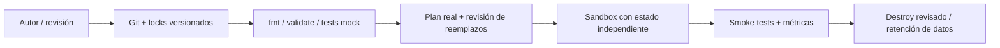

# IaC · cinco decisiones de arquitectura, cinco demos

Portfolio ejecutable de Terraform. Cada raíz tiene un propósito, estado independiente,
inputs de ejemplo, outputs, pruebas sin credenciales y un runbook con diagrama Mermaid.
No son cinco copias de una VM: muestran modularidad, resiliencia, perímetros privados,
identidad y operación de workloads.

| Template | Matiz | Evidencia técnica | Requisitos para apply |
|---|---|---|---|
| [01 · AWS network](templates/01-aws-network/) | Contrato de módulo y aislamiento | `for_each`, CIDR calculado, dos AZ, SG default cerrado, endpoint S3 | Cuenta AWS, AZ disponibles |
| [02 · AWS async](templates/02-aws-async/) | Resiliencia orientada a eventos | SQS, DLQ, IAM acotado, Lambda, fallos parciales, alarma | AWS con permisos IAM/Lambda/SQS |
| [03 · Azure private storage](templates/03-azure-private-storage/) | Identidad y perímetro de datos | Private Endpoint, DNS privado, ZRS, sin shared keys | Suscripción, nombre único, región con ZRS |
| [04 · GCP Cloud Run](templates/04-gcp-cloud-run/) | Serverless con identidad | Invoker explícito, digest inmutable, escala 0–3 | Proyecto con billing, imagen real, caller SA |
| [05 · Kubernetes platform](templates/05-kubernetes-platform/) | Guardrails de plataforma | PSA restricted, quota, PDB, probes, NetworkPolicy | Cluster con CNI que aplique políticas, imagen compatible |



## Inicio rápido

Terraform >= 1.7 y < 2; CI usa 1.14.8. Python 3.12 para el worker.
Los locks fijan proveedores; no ejecutar `init -upgrade` como paso rutinario.

```powershell
# Desde la raíz; descarga proveedores, no crea recursos cloud.
./scripts/validate.ps1

# Elegir UNA demo; editar todos los placeholders antes de plan real.
cd templates/01-aws-network
Copy-Item terraform.tfvars.example terraform.tfvars
terraform init -lockfile=readonly
terraform plan -out=demo.tfplan
terraform show demo.tfplan
terraform apply demo.tfplan
# Verificar con el runbook del template; luego revisar destrucción.
terraform plan -destroy -out=destroy.tfplan
terraform show destroy.tfplan
terraform apply destroy.tfplan
```

Linux/macOS: `cp terraform.tfvars.example terraform.tfvars`, y por cada raíz:
`terraform init -backend=false -lockfile=readonly`, `terraform validate`, `terraform test`.
Ejecutar también `terraform fmt -check -recursive` desde la raíz y
`python -m unittest discover -s tests -v`.

## Qué se demuestra y qué se verifica

- Tests mock: lógica, validaciones de inputs y propiedades de recursos, sin crear infraestructura.
- Validate: compatibilidad de configuración con el esquema del proveedor bloqueado.
- Plan real: permisos, referencias y diferencias contra el ambiente elegido.
- Apply + smoke: comportamiento real; los mocks no prueban cuotas, IAM efectivo, DNS o scheduling.

Este repo no configura credenciales ni ejecuta applies desde CI. Usar sesiones temporales:
AWS SSO/role, Azure CLI/workload identity, GCP ADC/impersonation y un contexto Kube explícito.
No agregar claves, kubeconfigs, planes ni estados a Git. `.gitignore` no sustituye un secret scanner.

## Estructura

```text
templates/
  01-aws-network/          # módulo local reutilizable
  02-aws-async/            # app/worker.py + infraestructura
  03-azure-private-storage/
  04-gcp-cloud-run/
  05-kubernetes-platform/
  # cada raíz: versions.tf, main.tf, example, README, tests, lock
scripts/validate.ps1
tests/test_worker.py
docs/operating-model.md
.github/workflows/validate.yml
```

## Lectura de nivel senior

[Modelo operativo](docs/operating-model.md): estados, bootstrap, drift, promoción,
rollback, blast radius y evolución a producción. Los README locales explican los
trade-offs y los recursos deliberadamente ausentes. Una arquitectura de demo no
es una plataforma productiva completa.

[Evidencia de validación](docs/validation.md): versiones, pruebas realizadas y alcance.

## Fuentes primarias

- [Terraform tests y mocks](https://developer.hashicorp.com/terraform/language/tests/mocking)
- [AWS provider](https://registry.terraform.io/providers/hashicorp/aws/latest/docs)
- [Azure Storage](https://registry.terraform.io/providers/hashicorp/azurerm/latest/docs/resources/storage_account)
- [Cloud Run v2](https://registry.terraform.io/providers/hashicorp/google/6.45.0/docs/resources/cloud_run_v2_service)
- [Kubernetes provider](https://registry.terraform.io/providers/hashicorp/kubernetes/latest/docs)
