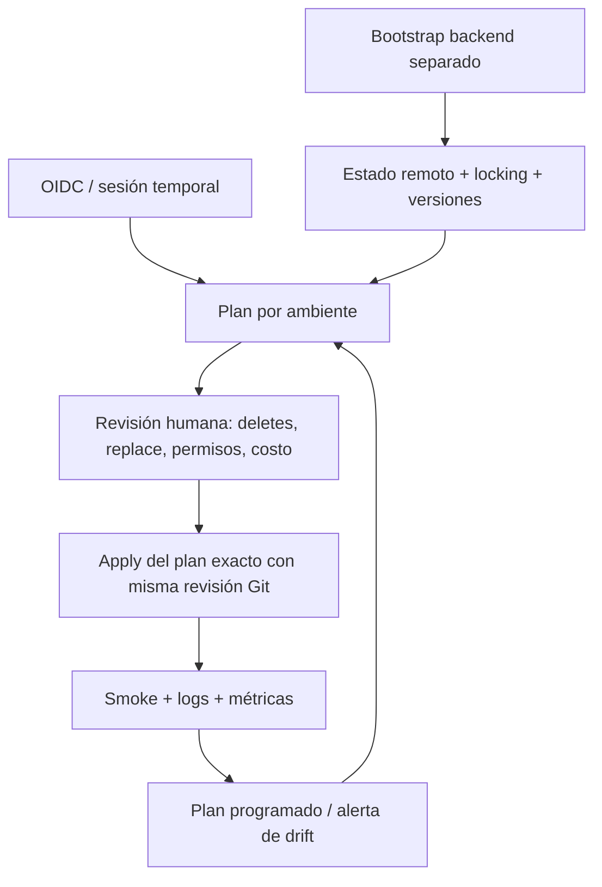

# Modelo operativo y decisiones transversales

## ADR-001 · cinco raíces, un lenguaje

**Decisión:** Terraform en todas las demos, estado por raíz y ambiente. Un módulo
local sólo donde aporta un contrato reutilizable (red). Evita mezclar cambios de
red, datos y workloads en un plan de gran blast radius. No envolver cada recurso
en un módulo: aumenta indirección sin aportar composición.

**Costo:** Terraform administra Kubernetes aquí para mostrar contratos homogéneos;
para entrega frecuente de aplicaciones, evolucionar a Argo CD/Flux y reservar
Terraform para clusters e identidad. Nunca administrar un mismo objeto desde ambos.

## ADR-002 · local primero, backend remoto como promoción explícita

El backend local permite ejecutar pruebas sin bootstrap cloud. Para colaboración,
crear antes un backend separado: S3 versionado/cifrado con locking, Azure Blob con
RBAC/lease o GCS con IAM/versionado. No alojar el backend en la misma raíz que va a destruirlo.

1. Crear backend con identidad administrativa de bootstrap.
2. Agregar `backend` a la raíz elegida; configuración no secreta por ambiente.
3. `terraform init -migrate-state`; revisar copia, serial y permisos.
4. Restringir identidad de CI al prefijo/contenedor correspondiente.
5. Probar exclusión concurrente y restauración de una versión antes de promover.

State puede contener datos sensibles aunque un output sea `sensitive`. Cifrar,
limitar acceso y auditar lecturas. No subir estados o planes como artefactos públicos.
No usar workspaces como sustituto de separación de cuentas/suscripciones/proyectos.

## Promoción y supply chain

CI de este repo sólo valida. Para producción, fijar Actions por SHA revisado,
identidad OIDC sin secretos persistentes y entornos GitHub con aprobación.
Generar plan con credenciales del ambiente; vincularlo al SHA, lock y versión de
Terraform. Caducarlo si cambia la revisión o el estado. Tratar plan/JSON como secreto.
No ejecutar código de PR externo con credenciales de apply.

Provider locks incluyen checksums Linux y Windows. Upgrade en PR dedicado con
`terraform init -upgrade`, revisión de cambios y repetición de pruebas. Imágenes
por digest en demos 04/05; el digest del ejemplo es un placeholder, no un artefacto publicado.

## Drift, incidentes y rollback

- Programar `terraform plan -detailed-exitcode`: 0 sin cambios, 2 diferencias,
  1 error. Alertar en 1 y 2; no aplicar drift automáticamente.
- Incidente: congelar applies, inspeccionar identidad, estado y auditoría cloud.
  Un cambio manual urgente se documenta y luego se reconcilia/importa.
- Rollback de código: revertir commit, generar NUEVO plan, revisar y aplicar.
  Volver a un commit no restaura datos borrados ni un recurso reemplazado.
- Recuperación de state: restaurar versión sólo tras comparar serial, lineage y
  recursos reales; `force-unlock` sólo cuando el propietario ya no ejecuta.
- Reintentos: corregir causa y regenerar plan; evitar loops ciegos de apply.
  Timeout no implica ausencia de creación: refrescar antes de repetir.

## Costos y salida

Sin precios inventados: varían por región, volumen y contratos. Red 01 no usa NAT;
02 consume requests/logs/Lambda; 03 tiene Private Endpoint, ZRS y versiones;
04 puede escalar a cero pero ingress, imagen y logs siguen teniendo costo;
05 usa capacidad existente y requiere presupuesto del cluster.
Configurar budgets cloud externos antes de una demo pública. Los límites de
concurrencia/instancias reducen consumo, no son un tope monetario.

Antes de destroy: confirmar cuenta/contexto, exportar datos necesarios, revisar
el plan de borrado. Eliminar el state no elimina recursos. Nunca tratar `state rm`
como limpieza. Para producción, retención/backups, locks de recursos y
`prevent_destroy` selectivo son decisiones explícitas, no un toggle genérico.

## Evolución priorizada

| Prioridad | Problema | Cambio | Costo / riesgo |
|---|---|---|---|
| Ahora al colaborar | Estado local sin exclusión | Backend remoto aislado | Bootstrap y migración |
| Antes de producción | Verificación mock insuficiente | Sandbox real + smoke automatizado | Costo, cuotas, credenciales temporales |
| Antes de producción | Alarmas sin entrega | Receptor/SLO y guardia | Operación y ruido |
| Después | Reglas sólo en tests locales | Policy-as-code sobre plan | Mantenimiento y falsos positivos |
| Experimental | Apps y plataforma acopladas | GitOps para workloads | Migración de ownership sin doble gestión |
