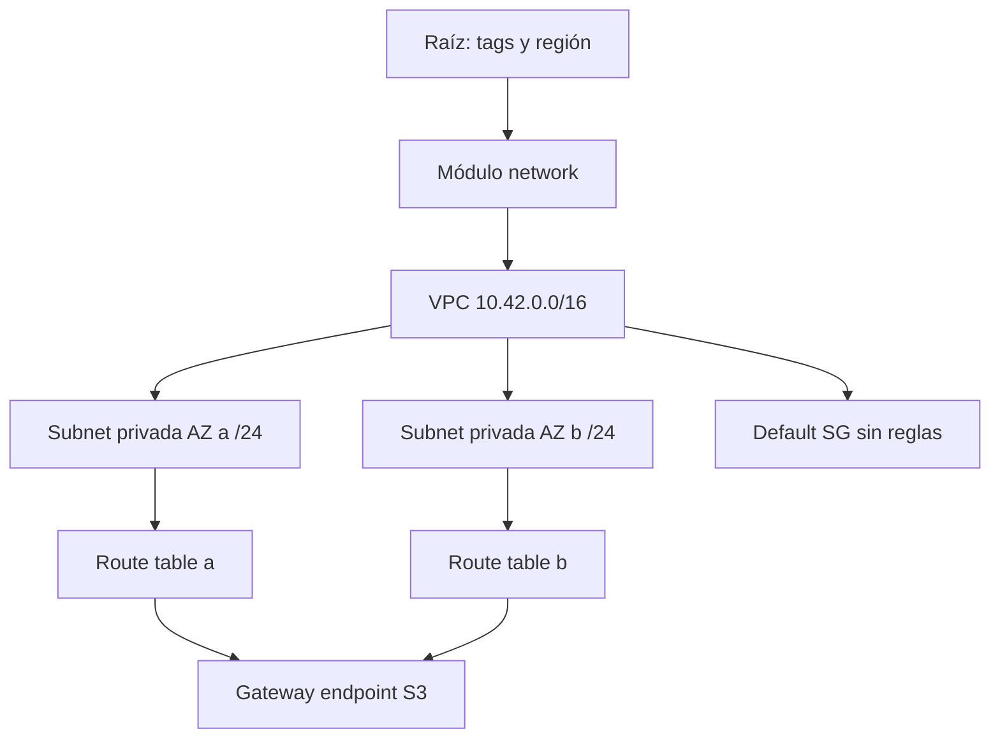

# Red privada AWS modular

## Arquitectura



## Decisiones y trade-offs

- `for_each` usa claves de zona, con outputs en mapa; evita direcciones basadas en índices de recursos.
- CIDR usa orden de claves: agregar una clave anterior puede renumerar subredes. Mantener claves estables; revisar replacements al ampliar. Una evolución productiva usaría CIDR explícito por zona.
- No hay IGW, NAT ni IP pública; sólo ruta local y endpoint S3. El endpoint no otorga IAM ni restringe por sí mismo buckets: añadir policy de endpoint y bucket según workload.
- Cierra el SG default existente. En una VPC nueva evita heredar permisos permisivos; importar esta lógica en VPC existente requiere auditar consumidores.
- Dos AZ no garantizan disponibilidad de aplicaciones: no se crean workloads ni balanceador.

## Inputs, outputs y permisos

`name` identifica recursos; `region` y `zones` deben concordar. Módulo recibe
`name`, `zones`, `cidr`; retorna `vpc_id` y `private_subnets`. Raíz usa CIDR fijo de
laboratorio; cambiarlo reemplaza red/subredes. Permisos: EC2 VPC/subnets/routes/endpoints/SG y Describe.

## Ejecución reproducible

Desde esta carpeta:

```powershell
Copy-Item terraform.tfvars.example terraform.tfvars
# Editar variables, confirmar cuenta / proyecto / contexto.
terraform init -lockfile=readonly
terraform validate
terraform test
terraform plan -out=demo.tfplan
terraform show demo.tfplan
terraform apply demo.tfplan
```

`terraform test` usa proveedores mock; no valida autorización o disponibilidad cloud.
El plan real y los smoke tests siguientes completan la validación del ambiente.

## Smoke y diagnóstico

```powershell
aws ec2 describe-subnets --filters Name=vpc-id,Values=<vpc_id> --query 'Subnets[*].[AvailabilityZone,CidrBlock,MapPublicIpOnLaunch]'
aws ec2 describe-route-tables --filters Name=vpc-id,Values=<vpc_id>
aws ec2 describe-vpc-endpoints --filters Name=vpc-id,Values=<vpc_id>
```
Esperar dos subredes sin IP automática, rutas sin default a Internet y endpoint
`available`. Smoke de S3 requiere lanzar un workload con IAM y SG explícitos; no está incluido.

## Costos, límites y evolución

No NAT reduce costo y superficie, pero bloquea descargas/APIs públicas. Endpoint
S3 gateway sin tarifa horaria propia; tráfico S3 y futuros workloads se facturan.
Para producción: Flow Logs con retención, IPAM, endpoint policy acotada y pruebas
de conectividad. Destroy no contiene datos, pero recursos ajenos en subredes pueden impedirlo.

## Limpieza

```powershell
terraform plan -destroy -out=destroy.tfplan
terraform show destroy.tfplan
terraform apply destroy.tfplan
```

Revisar recursos/datos antes de apply. Ver [modelo operativo](../../docs/operating-model.md)
para backend remoto, drift, rollback y promoción. ZIP/planes/state son locales e ignorados;
retirar artefactos locales sólo después de verificar que ya no se requieren.
