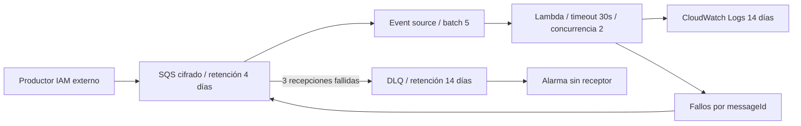

# Worker asíncrono AWS con aislamiento de fallos

## Arquitectura



## Decisiones y trade-offs

- Visibility 180s cubre 6 × timeout de 30s. Fallos parciales evitan reintentar registros correctos del mismo batch.
- SQS Standard entrega al menos una vez. Worker sólo valida/loguea; no implementa idempotencia durable. Para efectos reales, ledger con clave de negocio y escritura condicional antes de afirmar procesamiento exactamente una vez.
- IAM permite leer/borrar sólo jobs y escribir sólo su log group. No hay endpoint público ni VPC artificial para Lambda.
- DLQ acepta redrive desde la cola original. Retención mayor conserva mensajes tras agotar reintentos.
- Alarma detecta DLQ > 0; deliberadamente sin SNS/pager. No hay notificación hasta conectar un receptor.

## Inputs, outputs y permisos

Inputs `name`, `region`; outputs `queue_url`, `dlq_url`. El ZIP se genera desde
`app/worker.py`; `source_code_hash` detecta cambios. Permisos de despliegue incluyen
IAM role/policy y PassRole, SQS, Lambda y CloudWatch. Productor requiere su propia
policy `sqs:SendMessage`; no se otorga acceso cross-account.

## Ejecución reproducible

Desde esta carpeta:

```powershell
Copy-Item terraform.tfvars.example terraform.tfvars
# Editar variables, confirmar cuenta / proyecto / contexto.
terraform init -lockfile=readonly
terraform validate
terraform test
terraform plan -out=demo.tfplan
terraform show demo.tfplan
terraform apply demo.tfplan
```

`terraform test` usa proveedores mock; no valida autorización o disponibilidad cloud.
El plan real y los smoke tests siguientes completan la validación del ambiente.

## Smoke y diagnóstico

```powershell
aws sqs send-message --queue-url <queue_url> --message-body '{"job":"demo"}'
aws sqs send-message --queue-url <queue_url> --message-body '{"fail":true}'
aws logs tail /aws/lambda/iac-async --since 10m
aws sqs get-queue-attributes --queue-url <dlq_url> --attribute-names ApproximateNumberOfMessages
```
Esperar log de éxito sin payload; mensaje fallido llega a DLQ después de reintentos
(esperar varios minutos y métricas eventualmente consistentes). Revisar antes de
redrive; arreglar causa, no reenviar poison pills en bucle.

## Costos, límites y evolución

Requests SQS, duración Lambda y logs generan costo. Concurrencia 2 acota ejecución,
no presupuesto. Producción: alarmas edad/backlog/errors/throttles, receptor real,
idempotencia, trazas y pruebas de carga. Destroy borra colas y mensajes: exportar
trabajos pendientes antes. Rollback del worker requiere nuevo plan y hash del código.

## Limpieza

```powershell
terraform plan -destroy -out=destroy.tfplan
terraform show destroy.tfplan
terraform apply destroy.tfplan
```

Revisar recursos/datos antes de apply. Ver [modelo operativo](../../docs/operating-model.md)
para backend remoto, drift, rollback y promoción. ZIP/planes/state son locales e ignorados;
retirar artefactos locales sólo después de verificar que ya no se requieren.
