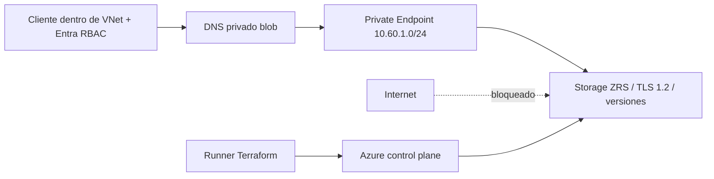

# Azure Storage con acceso privado e identidad

## Arquitectura



## Decisiones y trade-offs

- Desactiva red pública, shared keys y blobs públicos; autenticación de datos mediante Entra ID/RBAC asignado fuera de esta demo.
- Private Endpoint y zona DNS enlazada habilitan resolución privada desde VNet. DNS por sí solo no concede autorización.
- ZRS tolera fallo zonal; no es recuperación multi-región. Versioning + soft delete siete días ayudan ante borrados de blobs, no restauran una cuenta destruida.
- Sólo endpoint blob: files/queue/table necesitarían endpoints y DNS propios.
- No crea contenedores mediante data plane: el runner puede administrar recursos ARM sin estar dentro de VNet. Crear/listar blobs sí requiere conectividad privada y RBAC.

## Inputs, outputs y permisos

`subscription_id` obligatorio, `storage_name` globalmente único, minúsculo 3–24,
`location` con ZRS, `name`. Outputs `blob_endpoint`, `storage_id`. Login `az login`;
identity con permisos de red/storage/DNS en la suscripción. Cliente requiere
`Storage Blob Data Contributor` o Reader según operación; management Contributor no basta.

## Ejecución reproducible

Desde esta carpeta:

```powershell
Copy-Item terraform.tfvars.example terraform.tfvars
# Editar variables, confirmar cuenta / proyecto / contexto.
terraform init -lockfile=readonly
terraform validate
terraform test
terraform plan -out=demo.tfplan
terraform show demo.tfplan
terraform apply demo.tfplan
```

`terraform test` usa proveedores mock; no valida autorización o disponibilidad cloud.
El plan real y los smoke tests siguientes completan la validación del ambiente.

## Smoke y diagnóstico

```powershell
az storage account show --name <storage_name> --resource-group iac-private-rg --query '{public:publicNetworkAccess,keys:allowSharedKeyAccess,redundancy:sku.name}'
az network private-endpoint show --name iac-private-blob-pe --resource-group iac-private-rg --query privateLinkServiceConnections
# Ejecutar DENTRO de la VNet con DNS adecuado y RBAC de datos:
Resolve-DnsName <storage_name>.blob.core.windows.net
az storage container list --account-name <storage_name> --auth-mode login
```
Esperar public `Disabled`, keys `false`, ZRS, conexión `Approved`, DNS RFC1918.
Lista vacía es válida: esta demo no crea contenedores. Cliente público debe fallar.

## Costos, límites y evolución

Private Endpoint tiene tarifa y versiones incrementan almacenamiento. Para VPN/on-prem
se requiere forwarding DNS hacia Azure; no asumir que un link de VNet resuelve fuera.
Producción: diagnósticos a Log Analytics, backup/retención independiente, acceso de
emergencia y locks selectivos. Destroy elimina storage: soft delete de blobs no es
respaldo de la cuenta. No contiene datos de ejemplo.

## Limpieza

```powershell
terraform plan -destroy -out=destroy.tfplan
terraform show destroy.tfplan
terraform apply destroy.tfplan
```

Revisar recursos/datos antes de apply. Ver [modelo operativo](../../docs/operating-model.md)
para backend remoto, drift, rollback y promoción. ZIP/planes/state son locales e ignorados;
retirar artefactos locales sólo después de verificar que ya no se requieren.
