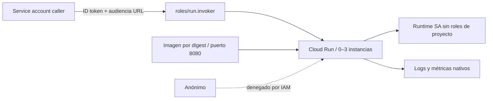

# Cloud Run autenticado e inmutable

## Arquitectura



## Decisiones y trade-offs

- URL accesible por Internet con IAM obligatorio: autenticado no equivale a red privada. No se asigna `allUsers`.
- Runtime SA y caller separados: despliegue necesita ActAs sobre runtime, caller necesita invoker y credenciales para ID token.
- Digest obliga a artefacto inmutable. Imagen REAL debe escuchar 0.0.0.0:8080 y ser accesible al servicio de Cloud Run; placeholder no despliega.
- Escala a cero, máximo tres instancias, 20 requests por instancia y timeout 30s: decisiones de costo/latencia para demo, no SLO garantizado.
- Activa API Run y conserva su habilitación al destroy. IAM de service account y registry/API de artefactos deben estar habilitados previamente.

## Inputs, outputs y permisos

Obligatorios `project_id`, `image`, `invoker_member`; opcionales `region`, `name`.
Outputs URL e identidad runtime. Usar `gcloud auth application-default login` o
impersonación en sandbox con billing. Desplegador necesita permisos Run, crear
service account, ActAs y habilitar Run API. Caller debe existir.

## Ejecución reproducible

Desde esta carpeta:

```powershell
Copy-Item terraform.tfvars.example terraform.tfvars
# Editar variables, confirmar cuenta / proyecto / contexto.
terraform init -lockfile=readonly
terraform validate
terraform test
terraform plan -out=demo.tfplan
terraform show demo.tfplan
terraform apply demo.tfplan
```

`terraform test` usa proveedores mock; no valida autorización o disponibilidad cloud.
El plan real y los smoke tests siguientes completan la validación del ambiente.

## Smoke y diagnóstico

```powershell
gcloud run services describe iac-run --region us-central1 --project <project_id>
# El operador necesita permiso para impersonar al caller.
$token = gcloud auth print-identity-token --impersonate-service-account=<caller_email> --audiences=<service_url>
Invoke-WebRequest <service_url> -Headers @{ Authorization = "Bearer $token" }
Remove-Variable token
# Request sin Authorization: esperar 401/403.
```
Esperar Ready y respuesta de la app con token; anónimo denegado. No imprimir tokens.
Si digest privado: revisar permisos del service agent sobre Artifact Registry.

## Costos, límites y evolución

Cold starts son costo de scale-to-zero. No hay datos persistentes ni roles cloud
para runtime. Logging nativo existe, pero no hay alertas/SLO ni dashboards creados.
Producción: ingress interno/LB si se necesita perímetro privado, alertas latencia/
5xx, Secret Manager con permisos acotados y despliegue gradual. Deletion protection
false facilita limpieza; activar en producción. Rollback: digest anterior y nuevo plan.

## Limpieza

```powershell
terraform plan -destroy -out=destroy.tfplan
terraform show destroy.tfplan
terraform apply destroy.tfplan
```

Revisar recursos/datos antes de apply. Ver [modelo operativo](../../docs/operating-model.md)
para backend remoto, drift, rollback y promoción. ZIP/planes/state son locales e ignorados;
retirar artefactos locales sólo después de verificar que ya no se requieren.
