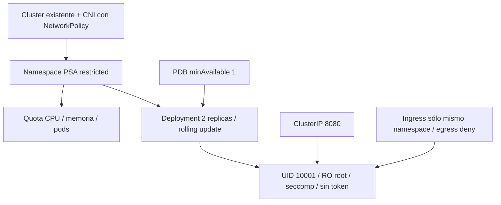

# Workload Kubernetes con guardrails

## Arquitectura



## Decisiones y trade-offs

- No crea cluster: separa lifecycle de plataforma y workload. Contexto obligatorio evita aplicar accidentalmente al contexto por defecto.
- PSA restricted, non-root, drop ALL, seccomp RuntimeDefault, raíz read-only y token automático desactivado.
- Quota permite dos réplicas y una de surge dentro de presupuesto; requests/limits ayudan scheduler y controlan consumo.
- PDB cubre interrupciones voluntarias; no evita crash ni pérdida de nodo. Spread es preferido (`ScheduleAnyway`) para permitir cluster de un nodo, no garantía multi-nodo.
- Ingress desde el mismo namespace a 8080, egress totalmente denegado. CNI sin soporte ignora políticas: verificar efectividad real.
- Imagen debe soportar UID 10001, escritura sólo /tmp y HTTP /: no cualquier nginx cumple ese contrato.

## Inputs, outputs y permisos

Inputs obligatorios `kube_context`, `image`; `kubeconfig_path` default ~/.kube/config,
`name` namespace. Outputs namespace y DNS. Permisos crear namespace y recursos
namespaced. Cluster con Pod Security Admission y CNI de políticas (p.ej. Calico/Cilium).
Imagen por digest accesible sin imagePullSecret; registro privado requiere agregarlo.

## Ejecución reproducible

Desde esta carpeta:

```powershell
Copy-Item terraform.tfvars.example terraform.tfvars
# Editar variables, confirmar cuenta / proyecto / contexto.
terraform init -lockfile=readonly
terraform validate
terraform test
terraform plan -out=demo.tfplan
terraform show demo.tfplan
terraform apply demo.tfplan
```

`terraform test` usa proveedores mock; no valida autorización o disponibilidad cloud.
El plan real y los smoke tests siguientes completan la validación del ambiente.

## Smoke y diagnóstico

```powershell
kubectl --context <context> -n iac-platform rollout status deployment/app --timeout=120s
kubectl --context <context> -n iac-platform get pods -o wide
kubectl --context <context> -n iac-platform get resourcequota,pdb,networkpolicy
kubectl --context <context> -n iac-platform port-forward service/app 8080:8080
# En otra terminal: Invoke-WebRequest http://localhost:8080/
```
Port-forward prueba app, NO NetworkPolicy. Con pods de prueba que respeten PSA y
quota, verificar conexión mismo namespace a 8080, rechazo desde otro namespace y
rechazo de egress desde app. Eliminar los probes al terminar. En cluster de un nodo
ambas réplicas pueden compartir host.

## Costos, límites y evolución

Cluster existente consume recursos aunque app esté ociosa. Quota no sustituye
budgets ni autoscaler del cluster. No instala metrics-server/HPA, ingress TLS ni
Prometheus. Producción: SLO, probes de dominio, imagen propia firmada, spread estricto
y GitOps. Destroy elimina namespace y cualquier recurso creado manualmente dentro:
namespace es propiedad exclusiva de esta demo.

## Limpieza

```powershell
terraform plan -destroy -out=destroy.tfplan
terraform show destroy.tfplan
terraform apply destroy.tfplan
```

Revisar recursos/datos antes de apply. Ver [modelo operativo](../../docs/operating-model.md)
para backend remoto, drift, rollback y promoción. ZIP/planes/state son locales e ignorados;
retirar artefactos locales sólo después de verificar que ya no se requieren.
